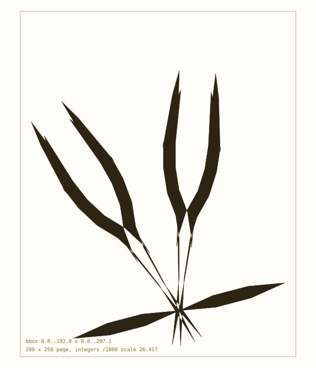
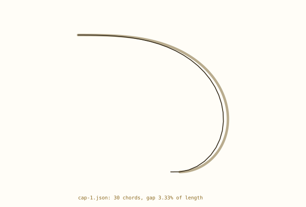

# Placement and transfer

A curve is useful only when it can be put somewhere. This asks two questions of the spine layer: can a finished figure be rotated and scaled onto the integer lattice, and can the caps and terminals be re-expressed on the new curve?

> Placement is exact exactly when the rotation comes from the chain's group. Quarter turns and triangle powers stay rational; 30 and 45 degrees do not, and belong to the float path.


## 1. The lattice rule

A chain's points are rational. Rotating by a triangle power or a quarter turn, scaling by a rational and translating by a rational keeps them rational, so they can be written as integers over one denominator (`place.lattice`) -- or snapped to a page grid in thousandths (`place.quantize`). `place.fit` takes the largest uniform scale that puts the figure inside a 200 x 250 box with a margin, then rounds to the grid.

```text
rotation      triangle power + quarter turn, exact
scale         rational (or an integer multiple of the lattice)
offset        rational
output        integers over one denominator, or grid units
outside group float only; quantized, not exact
```

| quantity | value |
| --- | --- |
| page | 200 x 250, +y up |
| rotation | triangle power 5 of 39-760-761 |
| scale | 26.417 |
| output | integers, thousandths of a unit |
| margin | 8 units |



*The fleur from the gallery, rotated inside the group, fitted to the page and rounded to thousandths.*

The point of the exercise is not the picture: it is that every vertex is an integer on a declared grid, so a design can be stored, tiled, compared and cut without a float deciding where a corner is. A rotation outside the group would break that, which is why the placement API asks for a `Dir` rather than degrees.


## 2. Caps: clothoid segments into a chain

All 36 caps in `out/caps` are clothoid segments in a local frame at the origin with angle zero -- they were made to be placed. Each segment is `(kappa0, kd, length)`, so the cap is a curve with curvature linear in arc length. The new curve is an Euler polygon of exactly that kind of curve, so a cap transfers by quantising each chord's turn to the triangle lattice.

```text
kappa(s)      kappa0 + kd*s
turn/chord    kappa(s_mid) * chord
lattice turn  round(turn / alpha) * alpha
error         measured against a fine integration of kappa
frame         anchor (0,0), heading east, angle 0 in every cap
```

| caps | 36 |
| --- | --- |
| segments | 77 |
| chords at 2 units | 7,490 |
| median gap | 0.44% of length |
| worst gap | 10.06% (cap-2.json) |



*A cap transferred to the lattice: the clothoid in faint, the quantised chain in ink.*

The residual is the lattice, not the arithmetic: each chord's turn is rounded to a whole triangle angle, so the gap grows with alpha and with curvature. At 0.05 degrees the median is under half a percent of the cap's length; the worst cases are the caps whose curvature changes fastest, and they want a finer alpha or shorter chords, both of which the float hybrid can now afford.


## 3. Terminals, now with a framework

The terminals are `150` ends across two extractors, stored as cubic spans in page units. They now carry a framework as well: `anchor` at the seam and `heading` outward, in page units with +y up, written by `scripts/extract-terminals.py` for every end. The first span can be a zero-length seam, so the direction comes from the first real one.

```text
terminals      cubic spans, page units
anchor         stored, +y up
heading        stored, outward
applies        150 ends (88 Stage Two, 62 LAC)
verified       heading·tangent 0.999999 minimum
```

Attachment is now the same operation as `fork`: read the framework, rotate by it, scale, translate. A cap placed at a terminal framework lands on the seam by construction rather than by eye.


## 4. What is ready

| operation | status |
| --- | --- |
| rotate inside the group | exact, tested |
| scale by a rational | exact, tested |
| fit to a 200 x 250 page | integer grid, tested |
| caps to the new curve | 36 cap files, median gap 0.44% |
| terminals with a framework | 150 stored, 2026-10-29 |
| arbitrary angles | float only; quantized |

Placement is the piece that had to exist first: caps, terminals, mirrors and branches all reduce to it. Both sides now have what they need; attaching one to the other is the next check.


## Reproduce

```text
cd pythagorean-spiral
../.venv/bin/python scripts/transfer.py
../.venv/bin/python -m unittest tests.test_place
```
